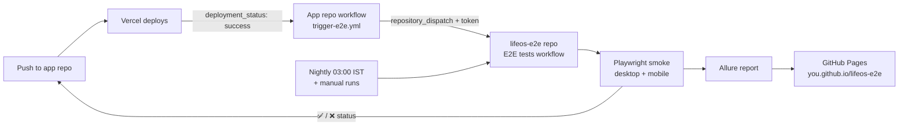

# CI/CD setup — lock it in, test after every deploy, publish Allure reports

*Three jobs, in order. Part 1 needs no code. Parts 2 and 3 use files that are already in the zips.*
*Replace `<you>` with your GitHub username everywhere.*

---

## Part 1 — Lock in what you have (about 15 minutes, no code)

### 1.1 Add the status badge
1. Open `README.md` in the **lifeos-e2e** repo → pencil icon (edit).
2. Make sure the first lines contain (with your username):
   ``
3. Commit. The badge turns **green/red** with the latest run on `main`.

### 1.2 Require smoke tests before merging
1. Repo → **Settings → Branches → Add branch protection rule** (or *Rules → Rulesets* in newer UIs).
2. **Branch name pattern:** `main`.
3. Tick **Require a pull request before merging** (leave "required approvals" at 0 — you work alone).
4. Tick **Require status checks to pass before merging** → in the search box choose **Smoke (desktop + mobile)**.
   *(It only appears in the list after the workflow has run at least once — it has.)*
5. Optional: tick **Do not allow bypassing the above settings** to apply it to yourself too. Save.

What changes: you can no longer push straight to `main`. The flow becomes **branch → pull request → smoke tests run → green → merge**.
If the check fails the **Merge** button stays blocked until you fix it.

> Branch protection needs a **public** repository (or a paid GitHub plan for private ones).

### 1.3 Confirm the nightly run works
1. Tomorrow morning open **Actions → E2E tests**.
2. Filter *Event: schedule*. You should see a run at about 03:00–03:30 IST containing **Smoke** and **Full regression** jobs.
3. Notes: GitHub can delay scheduled runs by 5–60 minutes at busy times, and **pauses schedules after 60 days without repo activity** — any commit wakes it up again.

### 1.4 Get an email when something breaks
See **Part 4** below (email alerts, how to test them, and what the new run summary shows).

---

## Part 2 — Run the tests after every app deployment

**How it works:** Vercel finishes a deployment → GitHub gets a `deployment_status` event in the **app repo** → a small workflow there sends a `repository_dispatch` message to the **e2e repo** with the site URL and commit id → the e2e workflow waits until the site answers, runs the smoke tests, and (optionally) writes ✅/❌ back onto the app's commit.

### 2.1 Check Vercel is reporting deployments to GitHub
App repo main page → right-hand sidebar → **Deployments**. You should see entries named **Production** (and **Preview** if you use pull requests). If the box is empty, in Vercel open *Project → Settings → Git* and make sure the GitHub repository is connected.

### 2.2 Create a token that lets the app repo start the e2e repo
GitHub → profile photo → **Settings → Developer settings** (bottom of the left menu) → **Personal access tokens → Fine-grained tokens → Generate new token**.

| Field | Value |
|---|---|
| Token name | `lifeos-app-to-e2e` |
| Expiration | 90 days (put a reminder in your calendar to renew it) |
| Resource owner | your account |
| Repository access | **Only select repositories → `lifeos-e2e`** |
| Permissions → Repository | **Contents: Read and write** (this is what GitHub requires to send a `repository_dispatch`) |

Generate and **copy the token now** (it is shown only once).

### 2.3 Store it in the **app repo**
App repo → **Settings → Secrets and variables → Actions**

- **Secrets** tab → *New repository secret* → name `E2E_DISPATCH_TOKEN`, value = the token.
- **Variables** tab → *New repository variable*:
  - `E2E_REPO` = `<you>/lifeos-e2e`
  - `E2E_PROD_URL` = `https://life-os-lake-three.vercel.app`  *(the stable public address; deployments are tested through it)*
  - *(optional)* `E2E_ON_PREVIEW` = `true` to also test **preview** deployments (see 2.6).

### 2.4 Add the trigger workflow to the **app repo**
App repo → **Add file → Create new file** → name it exactly `.github/workflows/trigger-e2e.yml` → paste the contents of the file from `app-repo-trigger.zip` → commit to `main`.
*(It must be on the default branch — GitHub only runs `deployment_status` workflows from there.)*

### 2.5 Update the **e2e repo** with the new files
Upload the files from `e2e-ci-update.zip` (same folder paths) to the `lifeos-e2e` repo — **Add file → Upload files**, drag the `.github`, `src`, `tests`, `docs` folders and `playwright.config.ts`, `README.md`.

### 2.6 Optional extras
**(a) ✅/❌ on the app's commit** — second token, so the result shows next to every commit in the app repo:
- New fine-grained token → Repository access: **only your app repo** → Permissions: **Commit statuses: Read and write**.
- Store it in the **e2e repo** as secret `APP_STATUS_TOKEN`.
- Result: on each app commit page you will see a check named **e2e / smoke** (pending → success/failure) that links to the e2e run.

**(b) Testing preview deployments** — Vercel protects preview URLs with a login by default. To let the tests in:
- Vercel → Project → **Settings → Deployment Protection → Protection Bypass for Automation** → add a secret and copy it.
- Store it in the **e2e repo** as secret `VERCEL_BYPASS_SECRET`.
- Set the app repo variable `E2E_ON_PREVIEW=true`.
The framework sends that secret **only** to the site under test (never to third parties).

### 2.7 Try it
1. Make a harmless commit in the **app repo** (for example add a line to its README).
2. Wait for Vercel to finish (~1 minute).
3. App repo → **Actions** → *Trigger E2E tests after deploy* should be green; its summary says what it sent.
4. **e2e repo → Actions**: a new run titled like `E2E (repository_dispatch · Production · a1b2c3d)`. Smoke runs against your site.
5. If you set up 2.6(a): the app commit now shows **e2e / smoke ✅**.

### 2.8 If something goes wrong

| What you see | Cause and fix |
|---|---|
| No *Trigger E2E* run at all in the app repo | The workflow file isn't on the default branch, or Vercel isn't linked to GitHub (see 2.1). |
| Red: `Secret E2E_DISPATCH_TOKEN is missing` / `Repository variable E2E_REPO is missing` | Typo in the name, or you created a *variable* where a *secret* is needed (token = secret, repo/URL = variables). |
| Red: `GitHub answered HTTP 404` | `E2E_REPO` is wrong (`owner/repo`), or the token wasn't granted access to `lifeos-e2e`. |
| Red: `HTTP 401` or `403` | Token expired, or it lacks **Contents: Read and write**. Create a new one (2.2) and update the secret. |
| *Wait until the site answers* says `HTTP 308` / `redirects to: …` | The address variable ends with `/` (older workflow versions) or the site really redirects elsewhere. Remove the trailing slash from `E2E_PROD_URL` / `E2E_BASE_URL`, or set it to the address named in the message. |
| e2e run starts but *Wait until the site answers* fails | The URL is wrong, the site is down, or it is a protected preview (use 2.6(b)). |
| No ✅/❌ on the app commit | `APP_STATUS_TOKEN` missing, or the token isn't for the app repo / lacks *Commit statuses*. |
| Runs happen for previews you didn't want | Remove or set `E2E_ON_PREVIEW` to something other than `true`. |

**Security:** both tokens are limited to one repo each and expire. Never commit a token. If one leaks, delete it on GitHub and make a new one.

---

## Part 3 — Allure report on GitHub Pages

> **Optional and OFF by default.** GitHub Pages is free for **public** repositories; private repositories need a paid plan. The job is skipped until you create the repository variable **`ALLURE_PAGES` = `true`**. Without it, you still get the normal Playwright HTML report in each run's Artifacts.

When switched on, every run (push to `main`, nightly, manual, after-deploy) ends with a **Publish Allure report** job: it collects the results of the smoke and regression jobs, builds an Allure report **with trend history**, and publishes it to the `gh-pages` branch. Pull-request runs don't publish.

### 3.1 One-time setup
1. The repo must be **public** (GitHub Pages on private repos needs a paid plan).
2. Let one workflow run finish — the *Publish Allure report* job creates the `gh-pages` branch.
   *(If the job fails with a permission error: repo **Settings → Actions → General → Workflow permissions** → **Read and write permissions** → Save → re-run.)*
3. Repo → **Settings → Pages** → *Build and deployment* → **Source: Deploy from a branch** → **Branch: `gh-pages`**, folder **`/ (root)`** → **Save**.
4. Wait 1–2 minutes. Your report is at:
   - **Latest:** `https://<you>.github.io/lifeos-e2e/` (redirects to `/latest/`)
   - **A specific run:** `https://<you>.github.io/lifeos-e2e/<run number>/`
   The link is also in each run's **Summary** page.

### 3.2 What the pipeline keeps
- `latest/` — the newest report (always replaced).
- `1/`, `2/`, … — the **last 20 runs** (older ones are deleted automatically).
- `history/` — Allure's trend data, fed into each new report so the **trend graphs** keep growing.

### 3.3 Reading an Allure report (2-minute tour)
| Tab | Use it for |
|---|---|
| **Overview** | Pass rate, trend over runs, environment (`BASE_URL`), link back to the GitHub run |
| **Suites** | Tests grouped by file/describe; click a test for steps, screenshots, video and trace |
| **Categories** | Failures grouped by error type — spot "all failed at sign-up" quickly |
| **Graphs** | Status, severity, duration, retries (**flaky** = passed only on retry) |
| **Timeline** | When each test ran on which worker — find slow tests |
| **Behaviors / Tags** | `@smoke` vs `@regression` filtering |

### 3.4 If something goes wrong

| What you see | Cause and fix |
|---|---|
| Pages URL shows 404 | Pages not enabled (3.1 step 3), wrong branch, or you opened it < 2 minutes after the first publish. |
| Report job red at *Publish to GitHub Pages* (403) | Workflow permissions (3.1 step 2). |
| Report is empty | The test jobs didn't upload `allure-results-*` (check the run's Artifacts) — the workflow sets `ALLURE=true` for that. |
| `allure-commandline` / Java error | Open the *Generate the report* step log; the job installs Java 17 itself. Re-run once — it downloads the tool from npm. |
| Trend graph has only one point | Normal for the first run; history accumulates from the second run on. |

---

## Part 4 — Failure alerts by email, run summary, automatic updates

### 4.1 Turn on the emails (2 minutes)
1. GitHub → profile photo → **Settings → Notifications**.
2. Scroll to **System → Actions**. Set **Notify me** to **Email** (add **On GitHub** and **GitHub Mobile** if you like push alerts on your phone).
3. Tick **Send notifications for failed workflows only** — otherwise you also get an email for every green run.
4. Check **Settings → Emails** for the address that receives them, and look in spam the first time.

**Who is emailed?** GitHub sends the failure to a *person*:
- **Nightly runs** → the person who last edited the `cron:` line in `e2e.yml` (you, from your last upload of that file).
- **After-deploy runs** → the owner of the token that sent the message (you).
- **Manual and push runs** → whoever started them.
If someone else ever edits the cron line, the nightly alerts go to them.

### 4.2 Test the alert (safe, 1 minute)
Actions → **E2E tests** → **Run workflow** → in *Site to test* type `http://not-secure` → Run.
The first step rejects it immediately (it must start with `https://`), the run turns red within seconds, and an email arrives within a few minutes. If you get none after ~10 minutes, recheck 4.1.

### 4.3 The run summary
Open any run → the **Summary** page now has a **Test results** table: passed / failed / **flaky** / skipped, a list of flaky and failed tests with their first error line, and the 5 slowest tests (a test ~11 s slower than its neighbours probably waited for the sign-up rate limit).
*Flaky = failed first, passed on retry.* A green run with flaky tests is still a problem waiting to happen: fix them.

The commit status on your pull requests now carries the numbers too, e.g. **Smoke tests passed (14 passed, 0 failed, 0 flaky in 2m 41s)**.

### 4.4 Faster pull-request gate
Staging previews run **two tests at a time** (production, nightly and manual runs stay at one). Compare the duration in the status text before and after your next few pull requests.

### 4.5 Automatic dependency and action updates (Dependabot)
The file `.github/dependabot.yml` makes GitHub open weekly pull requests that update npm packages (Playwright separately from the rest) and the GitHub Actions used in the workflows — which also removes the "Node 20 is deprecated" warning once the new action versions land.
Each Dependabot pull request runs the smoke tests; **merge it when it is green**, close it if it breaks something and tell me. The first ones appear within a day of uploading the file.

---

## What the pipeline looks like now

| Trigger | Jobs that run | Result |
|---|---|---|
| Push to `main` / pull request on e2e repo | Smoke | green tick (+ report on push) |
| After every app deployment | Smoke against the deployed URL | ✅/❌ on the app commit + report |
| Nightly 03:00 IST | Smoke → Full regression | Report + email on failure |
| Manual (*Run workflow*) | Smoke / regression / all, any URL | Report |

> **Honest note:** the shell logic of these workflows (URL check, waiting for the site, sending the deployment message, building and pushing the report site, pruning old reports) was exercised locally with stand-in tools. The GitHub-only parts — token permissions, Vercel's deployment events, Pages — run for the first time on your GitHub. If a step is red, the tables above are the first place to look, and I'm happy to debug from the log.
