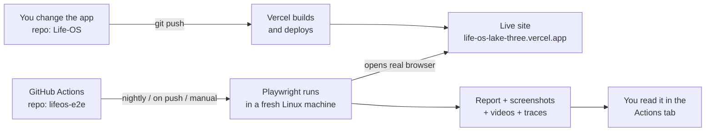

# LifeOS E2E Framework — the complete guide

*Who this is for: you, on day one. No CI/CD or framework knowledge assumed. Read sections 1–4 to understand it, section 7 to run it, and section 12 when you need to explain it in an interview.*

---

## 0. The 60-second version

- **What it is:** a separate project that opens your **live LifeOS website** in a real browser, clicks through it like a person (sign up, tick habits, add tasks, export a file, share a link…) and checks that everything works.
- **What "CI/CD" adds:** **GitHub Actions** runs those tests **automatically** — on every change, every night, and whenever you press a button — and keeps a report with screenshots, videos and traces of anything that failed.
- **Tools:** Playwright + TypeScript (what you already know), GitHub Actions, optional Allure reports.
- **Where it lives:** its **own GitHub repo** (`lifeos-e2e`), separate from the app. It only needs the app's URL.
- **Size today:** 7 smoke tests (run on desktop **and** phone size) + 40 regression tests = **54 test runs**.

---

## 1. The three ideas, in plain words

| Term | Plain meaning | In this project |
|---|---|---|
| **End-to-end (E2E) test** | A robot that uses the real website like a human, from the first click to the final result. | Playwright opens Chromium, signs up a fake user, ticks a habit, and checks the score says `8%`. |
| **CI — Continuous Integration** | Every time code changes, tests run automatically so problems are found in minutes, not weeks. | GitHub Actions runs the tests on every push / pull request. |
| **CD — Continuous Delivery/Deployment** | Every good change is shipped automatically. | Your app already does this: push to GitHub → **Vercel** deploys. Our framework is the **safety net** that checks the deployed site afterwards. |

### The whole pipeline



Two repos, two jobs: **the app repo ships the website; the e2e repo judges it.**

---

## 2. Should the framework be in a separate Git repo?

**Recommendation: yes — a separate repo called `lifeos-e2e`.** Reasons:

| | Separate repo (recommended) | Inside the app repo (`/e2e` folder) |
|---|---|---|
| **Portfolio** | A recruiter sees a whole *QA automation project* with its own README, CI badge and history. | Buried inside an app repo. |
| **Ownership** | Mirrors real companies where QA owns the test repo and its release cycle. | Tests and app are tangled together. |
| **Dependencies** | Only Playwright/TypeScript — tiny, quick `npm ci`. | Mixed with the app's React/Vite dependencies. |
| **Speed of CI** | No need to build the app; it just calls the URL. | Easy to run on every app PR. |
| **Weakness** | Doesn't automatically run when the *app* repo changes (see below). | — |

**How the two repos are connected:** only by the **URL** — the `BASE_URL` setting. The framework knows nothing about the app's source code. It uses *test ids* (like `data-testid="logout-button"`) that the app already exposes — that's the one agreement between them (listed in the app repo's `docs/TESTING.md`).

**How tests get triggered today (all four work out of the box — setup in [CI-CD-SETUP.md](CI-CD-SETUP.md)):**
1. **On push / pull request** *to the e2e repo* — proves the framework itself still works.
2. **Nightly at 03:00 IST** — the full regression suite against the live site.
3. **Manually** — Actions tab → *E2E tests* → *Run workflow* (choose smoke / regression / all, optional URL).
4. **After every app deployment** — a small workflow in the app repo tells this repo what was deployed (`repository_dispatch`); smoke runs against it and the result is written back as ✅/❌ on the app commit.

**Run after deploy:** done — see [CI-CD-SETUP.md](CI-CD-SETUP.md), part 2.

> Rule of thumb: **separate repo for the framework now; add the "run after deploy" link later.**

---

## 3. What's inside (folder map)

```
lifeos-e2e/
├─ .github/workflows/e2e.yml   ← the CI/CD pipeline (GitHub Actions)
├─ docs/FRAMEWORK-GUIDE.md     ← this file
├─ playwright.config.ts        ← global settings: URL, browsers, retries, reports, timezone
├─ package.json                ← scripts (npm run test:smoke …) and dependencies
├─ tsconfig.json               ← TypeScript rules
├─ .env.example                ← template for local settings (BASE_URL)
│
├─ src/                        ← the *framework* (reusable building blocks)
│  ├─ pages/                   ← Page Objects: one class per screen
│  │   ├─ base.page.ts            shared helper (find things by test id)
│  │   ├─ login.page.ts           sign up / sign in
│  │   ├─ app-shell.page.ts       greeting, navigation, logout, open settings
│  │   ├─ today.page.ts           habits, score, journal, weekly review
│  │   ├─ todo.page.ts            tasks
│  │   ├─ board.page.ts           charts, KPIs, badges
│  │   ├─ settings.page.ts        habits, reminders, programs, share, export, danger zone
│  │   └─ share.page.ts           the public shared page
│  ├─ fixtures/test.ts         ← the custom `test` function (creates & deletes accounts for you)
│  ├─ helpers/
│  │   ├─ user-factory.ts         makes a unique fake user for every test
│  │   ├─ dates.ts                "last Wednesday", "yesterday"… in UTC
│  │   ├─ persist.ts              waits until the app has saved to the server
│  │   └─ files.ts                reads downloaded CSV / Excel files
│  └─ data/                    ← test data tables (score cases, weekday schedule cases)
│
└─ tests/                      ← the actual test cases (what to check)
   ├─ smoke/                   ← fast, must-never-break checks (7 tests)
   └─ regression/              ← deeper checks (40 tests)
```

**The golden rule:** `tests/` says *what* to check. `src/pages/` knows *how to click it*. When the app's screen changes, you fix **one page object**, not 40 tests.

---

## 4. How one test works, start to finish

Take this smoke test: *"ticking a habit updates the score and survives a reload"*.

```ts
test('ticking a habit updates the score and survives a reload',
  { tag: ['@smoke'] },
  async ({ signedIn, today, shell, page }) => {
    await today.loadExample();
    await today.tickDo('Drink enough water');
    await today.expectScore('8%');
    await page.reload();
    await shell.expectReady();
    await today.expectDoDone('Drink enough water');
    await today.expectScore('8%');
});
```

What actually happens:

1. **Playwright reads `playwright.config.ts`** → knows the URL, browser, timezone (UTC), timeouts.
2. **Fixtures run before the test body.** `signedIn` is a fixture, so the framework automatically:
   - pins the browser clock to a known Wednesday (`test.use({ frozenAt: … })` at the top of the file) so "today" never changes the expected numbers,
   - creates a **brand-new unique user** (`lifeos-e2e+user-k3x9…@example.com`),
   - opens `/login`, clicks *Create account*, fills the form, submits,
   - waits until the greeting appears.
3. **The test body runs** using page objects:
   `loadExample()` clicks "Start from an example"; `tickDo()` clicks the habit and **waits for the autosave** (`persist`); `expectScore('8%')` checks the big percentage: (1 of 6 do's + 0 of 4 don'ts) ÷ 2 = 8.3% → `8%`.
4. **Reload** proves the data really reached the database.
5. **Teardown (automatic):** the `user` fixture signs in if needed, opens *Settings → Danger zone*, types `DELETE`, and deletes the account. No test users pile up.
6. **Reporting:** pass/fail goes into the HTML report; on failure you also get a screenshot, video and a **trace** (a time-travel recording of the test).

Every test gets its **own account**, so tests never affect each other. That's why they can safely run in parallel.

---

## 5. The building blocks (what each concept is *for*)

| Concept | Where | Why we use it |
|---|---|---|
| **Page Object Model** | `src/pages/*.ts` | One place per screen that knows the locators and actions. Tests read like sentences (`today.tickDo(...)`). |
| **Fixtures** | `src/fixtures/test.ts` | Playwright's dependency injection. A test just asks for `signedIn` or `today` and gets it ready (and cleaned up). |
| **Test ids** | `data-testid="…"` in the app | Stable handles that don't break when text or colours change. Where a visible label is unique we use roles/text instead. |
| **Tags** | `{ tag: ['@smoke'] }` | Choose what to run: `--grep @smoke` vs `--grep @regression`. |
| **Data-driven tests** | `src/data/*.ts` + `for` loops | One test body, many rows of data (6 score cases, 5 weekday cases) — adding a case = adding a row. |
| **Time control** | `page.clock.setFixedTime(...)` | Tests about "Sunday review", weekday schedules, overdue tasks need a known date. We pin the browser clock. |
| **`persist()` helper** | `src/helpers/persist.ts` | The app saves ~0.4 s after a change. This waits for the server's reply, so reloads are reliable (no `sleep`s). |
| **Auto-cleanup** | `user` fixture | Deletes the test account through the real *Delete my account* feature (which is itself tested). |
| **Retries & traces** | `playwright.config.ts` | In CI a failed test is retried once; flaky vs real failures become visible, and traces are kept for failures. |
| **Two projects** | `chromium`, `mobile-chrome` | Smoke tests run on desktop *and* a Pixel-7-sized screen (bottom navigation instead of the sidebar). The same page-object method (`shell.goTo('board')`) works for both. |

### Why some choices matter
- **No `waitForTimeout` sleeps** — with one documented exception: an 11-second pause when the server answers "Too many requests" (see `LoginPage.attempt`). Otherwise Playwright auto-waits for elements and `persist()` waits for the network.
- **`test.use({ frozenAt })` is set *before* sign-up** and always uses a date in the **past**, so login sessions stay valid.
- **Fixed timezone (UTC)** means the same results on your laptop in Pune and on GitHub's servers.

---

## 6. The GitHub Actions workflow, line by line (`.github/workflows/e2e.yml`)

**Triggers (`on:`)**
- `push` to `main` and `pull_request` → quick feedback when the framework changes.
- `schedule: cron "30 21 * * *"` → 21:30 UTC = **03:00 IST** every night.
- `workflow_dispatch` → the **Run workflow** button, with inputs: `base_url` (optional) and `suite` (smoke / regression / all).

**Settings shared by all jobs (`env:`)** — the site URL, chosen by priority:
1. the URL you typed when running manually,
2. the repository **variable** `E2E_BASE_URL` (Settings → Secrets and variables → Actions → *Variables*),
3. the default production URL.

**Job 1 — `smoke`** (always runs, ~3–6 minutes)
1. `actions/checkout` – download the repo onto the fresh Linux machine.
2. `actions/setup-node` – Node 22 with npm caching (faster installs).
3. `npm ci` – exact dependency versions from `package-lock.json`.
4. `npx playwright install --with-deps chromium` – the browser and its system libraries.
5. `npm run typecheck` – catches TypeScript mistakes before any browser starts.
6. `npx playwright test --grep @smoke` – runs the smoke tests on desktop + mobile.
7. `upload-artifact` (with `if: always()`) – keeps the HTML report, Allure results and failure screenshots/videos/traces for 14 days, **even when tests fail**.

**Job 3 — `allure-report`** (after every non-PR run): downloads the Allure results of the other jobs, generates an Allure report **with trend history**, and publishes it to the `gh-pages` branch (GitHub Pages). Details: [CI-CD-SETUP.md](CI-CD-SETUP.md), part 3.

**Job 2 — `regression`** (only nightly, or when you choose *regression/all* manually)
- `needs: smoke` → if smoke fails, don't waste time on 40 more tests.
- Runs `--project=chromium --grep @regression`, same artifacts.

**Safety nets:** `concurrency` cancels older runs on the same branch; `timeout-minutes` stops a stuck job; `forbidOnly` (in the config) fails the build if someone forgets a `test.only`.

**Reading a run:** GitHub → *Actions* tab → click the run → red/green jobs → **Artifacts** at the bottom → download `smoke-reports` → open `playwright-report/index.html`. Failed Playwright tests also show as annotations on the run summary.

---

## 7. First-time setup, step by step

> **Before anything:** deploy the small app patch (`app-patch-v4.1`) to your app repo — it adds the login-page test ids, board KPI test ids and fixes the weekly-review card bug. The tests depend on them.

1. **Install Node.js 22** (check with `node -v`).
2. **Create an empty GitHub repo** named `lifeos-e2e` (no README, no .gitignore).
3. **Unzip** the framework into a folder, open a terminal there and run:
   ```bash
   npm install
   npx playwright install --with-deps chromium
   cp .env.example .env        # Windows: copy .env.example .env
   ```
   `npm install` creates **`package-lock.json`** — keep it and commit it. GitHub Actions installs from it (`npm ci`) so the cloud uses exactly the same versions as your laptop.
4. **First run (smoke):**
   ```bash
   npm run test:smoke
   npm run report            # opens the HTML report
   ```
5. **Watch it happen:** `npm run test:headed` or the friendly `npm run test:ui` (best for learning).
6. **Push to GitHub:**
   ```bash
   git init && git add . && git commit -m "feat: LifeOS e2e framework"
   git branch -M main
   git remote add origin https://github.com/<your-username>/lifeos-e2e.git
   git push -u origin main
   ```
7. **Set the URL variable** in the e2e repo: *Settings → Secrets and variables → Actions → Variables → New repository variable* → name `E2E_BASE_URL`, value `https://life-os-lake-three.vercel.app`.
8. **Run it in the cloud:** *Actions → E2E tests → Run workflow → suite: smoke*. Watch the green ticks, then download the report.
9. *(Optional)* add the green/red badge to the README:
   ``

**Heads-up:** the framework was written and type-checked, and its core techniques were exercised in a real browser, but it has **not yet been run against your live site**. Expect a handful of small fixes on the first run (a selector, a timing). That is normal — and fixing them with the trace viewer is the best way to learn the framework. See section 8.

---

## 8. Everyday workflow

**Run things**
| Goal | Command |
|---|---|
| Smoke only | `npm run test:smoke` |
| Regression only | `npm run test:regression` |
| One file | `npx playwright test tests/regression/todo.spec.ts` |
| One test by name | `npx playwright test -g "completing, filtering"` |
| Phone size | `npm run test:mobile` |
| See the browser | `npm run test:headed` |
| Interactive time-travel UI | `npm run test:ui` |
| Step through with the inspector | `npm run test:debug` |
| Open last report | `npm run report` |
| Open a trace | `npx playwright show-trace test-results/<folder>/trace.zip` |

**A test failed — how do I find out why?**
1. Open the report → click the red test → look at the **error line** and **screenshot**.
2. Open the **trace**: you can scrub through every action, see the page at that moment, the network calls, and the console.
3. Decide which of these it is:

| Symptom | Probable cause | Fix |
|---|---|---|
| `locator.click: element not found` | The app's markup/test id changed | Update the **page object** (one place). |
| Passes locally, fails in CI | Timing, or different timezone/locale | Use `persist()`/web-first `expect`, never sleeps. The config already pins UTC. |
| Expectation `79%` got `80%` | App scoring logic changed | Real bug *or* intended change → talk to the app owner, update `src/data/score-cases.ts`. |
| Everything fails at sign-up | Site down, DB down, or wrong `BASE_URL` | Run the health test: `npx playwright test health`. The failure message now quotes the app's own error text. |
| `Sign-up was rejected by the app: "…Too many requests… (429)"` | The server limits sign-ups/sign-ins per IP address and CI sends many from one machine | The framework retries after a pause and CI uses one worker. If it still happens, ask for a higher limit on the staging site. |
| Done task "disappears" in a to-do test | The To-do tab shows *Open* tasks by default | Switch the filter (`todo.filter('done')`) before asserting. |
| Random failures only on weekends | A test depended on today's date | Pin the clock with `frozenAt`. |

**Add a new test (recipe)**
1. Does a page-object method exist for the action? If not, add it to the right file in `src/pages/`.
2. Create `tests/regression/my-feature.spec.ts`:
   ```ts
   import { test, expect } from '../../src/fixtures/test';
   test('my feature works', { tag: ['@regression'] }, async ({ signedIn, today }) => {
     await today.loadExample();
     // …actions through page objects, then web-first assertions
   });
   ```
3. Run it alone, then commit. Mark the most important 3–5 tests `@smoke`.

**When the app adds a feature:** ask the app owner for `data-testid`s, add a page-object method, write the test. (Test ids already available are listed in the app repo's `docs/TESTING.md`.)

---

## 9. Test data & safety

- Every test **creates its own user** and **deletes it afterwards** — through the real UI, so nothing leaks into other tests.
- If a run is killed halfway, an orphan `lifeos-e2e+…@example.com` account may remain. It's harmless; you can delete them later. (Keep accounts on purpose with `E2E_KEEP_DATA=true` when you want to inspect one.)
- Emails use `example.com`, a reserved domain — **nothing is ever emailed to a real person**.
- Running against **production** is fine for smoke and nightly checks at this size. For heavy use, point `E2E_BASE_URL` at a **staging** copy (a second Vercel project with its own free Neon database branch) and keep production for smoke only.
- Never commit `.env`, passwords or tokens. (This framework needs no secrets today — the URL is public.)

---

## 10. What is covered today

| Area | Tests |
|---|---|
| Auth | sign up, log out/in, wrong password, duplicate email, signed-out redirect |
| Health | `/api/auth/diagnostics` says database connected and tables ready |
| Daily log | tick a habit, score, persistence after reload, all tabs open |
| Scoring (data-driven) | 6 combinations of do's/don'ts + "gave in" |
| Habit schedules (data-driven) | Mon/Wed/Fri/Sat/Sun counts, custom weekdays-only habit, rest day |
| To-do list | grouping (overdue/today/upcoming/none), complete/filter/clear, reopen/delete, add from Today |
| Board | empty state, perfect day → KPIs and badges, week/month/year views |
| Weekly review | Sunday card (incl. the *"doesn't vanish while typing"* regression), Monday catch-up, no prompt midweek |
| Programs | start a new 30-day program → history + day counter |
| Export | daily CSV exact row, to-do CSV, Excel with 8 sheets, JSON backup round-trip |
| Sharing | public page shows progress but **not** private notes; revoke; regenerate; unknown link |
| Settings/account | add/remove habit, Start over, dark mode persistence, delete account, in-app reminder banner |

---

## 11. Roadmap (in a sensible order)

1. **Get smoke green** on the live site; fix any first-run selector/timing issues.
2. ~~Allure report on GitHub Pages~~ — **done** (CI-CD-SETUP.md, part 3).
3. ~~Run after every deploy~~ — **done** (CI-CD-SETUP.md, part 2).
4. **Slack/Teams/e-mail notification** on nightly failure.
5. **Staging environment** (second Vercel project + Neon branch) so regression never touches production data.
6. **API tests** (Playwright `request`) for sign-up/health, plus **accessibility checks** with `@axe-core/playwright`.
7. **Visual regression** screenshots of the Board charts, and **sharding** (`--shard=1/3`) when the suite grows past ~15 minutes.

---

## 12. How to explain this in an interview

**60-second pitch**
> "I built an end-to-end test framework in Playwright and TypeScript for a habit-tracking web app I deployed on Vercel. It uses the Page Object Model and custom fixtures — every test signs up its own user and deletes it afterwards, so tests are isolated and run in parallel. Smoke tests run on desktop and mobile viewports; the regression suite includes data-driven cases for scoring and weekday schedules, and I control the browser clock to test date-dependent features like the Sunday weekly review. A GitHub Actions pipeline runs smoke on every change, the full regression nightly, and on demand, uploading HTML and Allure reports with traces for every failure."

**Questions you can now answer**
- *Why a separate repo?* Independent lifecycle, owned by QA, small dependency set, runs against any environment via `BASE_URL`; can be triggered by the app's deploy pipeline.
- *How do you avoid flaky tests?* Isolated data per test, web-first assertions with auto-waiting, no fixed sleeps, a `persist()` helper that waits on the real network response, pinned clock and timezone, one retry in CI with traces so flakiness is visible, not hidden.
- *What do you run on a PR vs nightly?* Smoke on changes (minutes); full regression nightly; manual runs for any URL.
- *How do you handle test data?* Create via UI, delete via UI (which also tests *Delete account*); unique `example.com` emails; staging for heavy runs.
- *How would you scale it?* Sharding across machines, merge reports, a staging environment, tag-based suites, API-level setup to speed up preconditions.
- *What's in the pipeline?* checkout → Node + cache → `npm ci` → browser install → typecheck → tests → artifacts (always) → regression only after smoke passes.
- *How are secrets handled?* Repo **variables** for non-secret config, **secrets** for credentials; none are needed here; `.env` is git-ignored.

---

## 13. Glossary

- **Assertion** – a check (`expect(...)`) that fails the test if untrue.
- **Auto-waiting** – Playwright waits for an element to be ready before acting on it.
- **Artifact** – a file saved by a CI run (reports, screenshots).
- **Cron** – a schedule format (`30 21 * * *` = 21:30 every day).
- **Fixture** – reusable setup/teardown injected into tests.
- **Flaky test** – one that sometimes passes and sometimes fails without any code change.
- **Locator** – how Playwright finds an element (`getByTestId`, `getByRole`…).
- **Page Object** – a class representing one screen.
- **Regression** – checking that old features still work after changes.
- **Runner** – the machine that executes a CI job (here `ubuntu-latest`).
- **Smoke test** – a tiny set of checks that proves the app is basically alive.
- **Trace** – a recording of a test run you can replay step by step.
- **Workflow** – a YAML file describing a CI pipeline.
