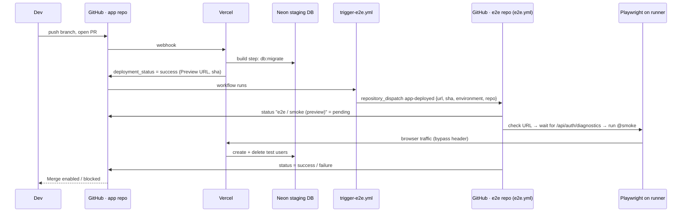

# LifeOS — the test framework and the CI/CD pipeline, explained end to end

*Purpose: after reading this you can draw the whole system on a whiteboard, explain every file and every arrow, say
**why** each decision was made, and answer follow-up questions in an interview. It describes the system **as it will be
once `STAGING-SETUP.md` is finished** (preview + staging database + merge gate). Things that are optional or not yet
switched on are marked **(optional)**.*

**Contents**
1. The system on one page
2. Words you will use
3. Environments (local / preview-staging / production)
4. The two repositories and what is in each
5. The test framework, layer by layer
6. One test followed through every layer (and the app, network and database)
7. Special mechanisms: the problem each one solves
8. The CI/CD pipeline in detail
9. Scenarios with timelines
10. Before vs. after staging
11. Debugging playbook
12. Design decisions and trade-offs
13. Real problems we hit and fixed (your interview stories)
14. Interview preparation
15. Cheat sheet
16. Glossary

---

## 1. The system on one page

```
 ┌───────────────────────────── APP REPO (website) ──────────────────────────────┐
 │  source code · migrations · test ids (data-testid) · /api/auth/diagnostics     │
 │  .github/workflows/trigger-e2e.yml  ← "tell the test repo what was deployed"   │
 └───────────────┬──────────────────────────────────────────▲────────────────────┘
        push / PR │                                          │ ✅/❌ commit status
                  ▼                                          │   "e2e / smoke (preview|production)"
            ┌──────────┐   build runs db:migrate     ┌───────┴──────────────────────────────────┐
            │  VERCEL  │────────────────────────────►│ NEON databases                           │
            │ builds & │   Preview  → staging DB     │   production DB  ·  staging DB (empty)   │
            │ deploys  │   Production → production DB└──────────────────────────────────────────┘
            └────┬─────┘
                 │ deployment_status = success (URL, commit)
                 ▼
   trigger-e2e.yml  ──repository_dispatch (token)──►  ┌──────────── E2E REPO (lifeos-e2e) ─────────────┐
                                                        │ .github/workflows/e2e.yml                      │
                                                        │   wait for site → run Playwright → report      │
                                                        │ src/ pages · fixtures · helpers · data         │
                                                        │ tests/ smoke · regression                      │
                                                        └──────────────┬─────────────────────────────────┘
                                                                       │ real Chromium (desktop + phone size)
                                                                       ▼
                                                              the deployed website under test
```

In ten sentences:
1. You change the app and open a pull request.
2. **Vercel** builds a **preview** of that pull request. The build applies database migrations to the **staging**
   database (never production).
3. Vercel tells GitHub "deployment succeeded" (`deployment_status`).
4. A small workflow in the **app repo** (`trigger-e2e.yml`) receives that event and sends a `repository_dispatch`
   message to the **e2e repo**, carrying the preview URL and the commit id.
5. The **e2e repo's workflow** (`e2e.yml`) starts, marks the commit "pending", waits until the preview answers, and
   runs the **smoke tests** with Playwright in a real browser.
6. Each test creates its **own throw-away user** on the preview, does its job, and **deletes** the user afterwards.
7. When the run ends, the e2e workflow writes **success or failure** back onto the app commit as the status
   `e2e / smoke (preview)`.
8. **Branch protection** in the app repo refuses to merge the pull request until that status is green.
9. After the merge Vercel deploys **production**, and the same chain runs a last smoke check there
   (`e2e / smoke (production)`).
10. Every night the **full regression** suite runs; you can also start any suite by hand against any URL.

---

## 2. Words you will use

| Word | Meaning here |
|---|---|
| **E2E test** | A robot uses the real website in a real browser, like a person. |
| **Smoke / regression** | Smoke = a few must-never-break checks (fast). Regression = the deep suite. Selected by *tags* (`@smoke`, `@regression`). |
| **CI** | Tests run automatically on every change. |
| **CD** | Verified code is released automatically. (Vercel does the releasing; our tests judge the result.) |
| **Environment** | A complete running copy of the app: *Preview/staging* and *Production*. |
| **Preview deployment** | Vercel builds one for every pull request, at its own URL. |
| **Workflow** | A YAML file in `.github/workflows/` that GitHub Actions runs. |
| **Runner** | The temporary Linux machine that executes a workflow job. |
| **Secret / variable** | GitHub settings the workflows read. Secrets are hidden; variables are plain. |
| **Token (PAT)** | A password-like key that lets one repo act on another. We use *fine-grained* ones (one repo, one permission, expires). |
| **`repository_dispatch`** | A message sent through GitHub's API that starts workflows in a repo. |
| **Commit status** | A ✅/❌/⏳ label with a name, attached to a commit. Branch protection can require it. |
| **Page Object** | A class that represents one screen of the app (knows its locators and actions). |
| **Fixture** | Playwright's way of preparing and cleaning up what a test needs (a user, a logged-in browser…). |
| **Test id** | `data-testid="..."` — an attribute the app exposes so tests can find elements reliably. |

---

## 3. Environments

| | **Local** | **Preview (= staging)** | **Production** |
|---|---|---|---|
| Created by | `npm run dev` | Vercel, for each pull request | Vercel, on merge to `main` |
| URL | `localhost:8080` | unique per deployment (`life-xxxx-….vercel.app`) | `life-os-lake-three.vercel.app` |
| Database | in-memory (PGlite) | **staging** Neon DB (empty, only test data) | **production** Neon DB (real users) |
| Vercel password | no | **yes** (tests pass it a bypass secret) | no |
| Sign-up rate limit | on | **off** (`AUTH_RATE_LIMIT=off`) | **on** (cannot be switched off) |
| Env variables | `.env` | Vercel *Preview* values | Vercel *Production* values |
| Tests that run | whatever you run by hand | **smoke** (the merge gate) | **smoke** after deploy, **full regression** nightly |

Key mechanism: **Vercel environment variables can have a different value per environment.** `DATABASE_URL`,
`BETTER_AUTH_SECRET`, `BETTER_AUTH_URL` and `AUTH_RATE_LIMIT` are set differently for Preview and Production. The app's
build command is `vite build && npm run db:migrate`, so **every deployment migrates the database that belongs to its own
environment** — that is why the Preview must never share the production `DATABASE_URL`.

---

## 4. The two repositories

### 4.1 App repo (`LifeOS`) — what matters for testing
| Thing | Why it exists |
|---|---|
| `data-testid` attributes (login form, nav, habits, tasks, board KPIs, settings, share page…) | The **contract** between app and tests. Listed in the app repo's `docs/TESTING.md`. |
| `/api/auth/diagnostics` | Health endpoint: is the database connected, are the tables created, is the secret set. Used by the health test and by the workflow's "wait for the site" step. |
| *Delete my account* feature | Lets tests clean up after themselves through the real UI (and is itself tested). |
| Deterministic logic (scoring, schedules, review prompt) | Same input → same output, so tests can assert exact numbers. |
| The app reads the **browser clock** | Lets tests pin the date (e.g. "a Sunday") to test date-dependent features. |
| `src/lib/auth/server.ts` | Trusts the Vercel domains; contains the **staging-only** rate-limit switch. |
| `.github/workflows/trigger-e2e.yml` | The workflow that notifies the e2e repo (section 8.3). |
| `vercel.json`, `npm run build` | Install + build + **database migration** for each deployment. |

### 4.2 E2E repo (`lifeos-e2e`) — every file
```
lifeos-e2e/
├─ .github/workflows/e2e.yml     the CI/CD pipeline (section 8.2)
├─ playwright.config.ts          global settings: URL, timeouts, retries, reporters, projects, timezone
├─ package.json / package-lock   scripts and pinned dependencies (CI installs with `npm ci`)
├─ tsconfig.json                 TypeScript rules (strict)
├─ .env.example                  template for local settings
├─ src/
│  ├─ helpers/                   small reusable utilities (no knowledge of screens)
│  │   dates.ts  user-factory.ts  persist.ts  files.ts  vercel-bypass.ts  guest.ts
│  ├─ pages/                     Page Objects: one class per screen
│  │   base.page.ts  login.page.ts  app-shell.page.ts  today.page.ts  todo.page.ts
│  │   board.page.ts  settings.page.ts  share.page.ts
│  ├─ fixtures/test.ts           the custom `test` function (accounts, clock, bypass, page objects)
│  └─ data/                      tables for data-driven tests (score-cases.ts, schedule-cases.ts)
├─ tests/
│  ├─ smoke/        auth.spec.ts · health.spec.ts · daily-log.spec.ts          (7 tests, tagged @smoke)
│  └─ regression/   scoring · habit-schedule · todo · board · weekly-review ·
│                   program · export · share · settings-account                (41 tests incl. 2 in auth.spec)
└─ docs/            this guide, the setup guides
```
Test counts: 7 smoke tests run on **two projects** (desktop + phone) = 14 runs; 41 regression tests run on desktop =
**55 test runs** in total.

---

## 5. The test framework, layer by layer

Think of it as a stack. **Each layer only knows about the layers below it** — that is what keeps it maintainable.

```
 tests/*.spec.ts          WHAT to check ("a perfect day scores 100%")
        │ uses
 src/fixtures/test.ts     SETUP/TEARDOWN ("give me a signed-in user, delete it afterwards")
        │ builds
 src/pages/*.page.ts      HOW to operate each screen ("tick this habit")
        │ uses
 src/helpers/*.ts         TOOLS (wait for save, make a user, pin the date, read a download)
        │ run on
 playwright.config.ts     RULES (URL, browser, timeouts, retries, reports)
        │ drives
 the real website         (testids are the handshake)
```

### Layer 0 — `playwright.config.ts` (the rulebook)
| Setting | Value | Why |
|---|---|---|
| `baseURL` | from env `BASE_URL`, trailing `/` removed | Same tests run against any environment. |
| `timezoneId: 'UTC'`, `locale: 'en-US'` | fixed | "Today", weekdays, date formats identical on your laptop and on GitHub's servers. |
| `fullyParallel: true` | on | Tests are independent (each has its own user), so they *can* run in parallel… |
| `workers` | **1 in CI**, auto locally | …but in CI we run one at a time to stay under sign-up rate limits and keep logs readable. |
| `retries` | 1 in CI, 0 locally | A failure that passes on retry is reported as **flaky** — visible, not hidden. |
| `forbidOnly` | on in CI | A forgotten `test.only` fails the build. |
| `timeout` / `expect.timeout` | 60 s / 10 s | Per test / per assertion. |
| `trace`, `screenshot`, `video` | kept on failure | Evidence to debug a CI failure without re-running it. |
| `reporter` | list + HTML (+ `github` annotations in CI, + Allure when enabled) | Console, downloadable report, inline annotations. |
| **projects** | `chromium` (desktop) and `mobile-chrome` (Pixel 7, **only `@smoke`**) | Smoke runs at both screen sizes; the deep suite only on desktop. |

### Layer 1 — helpers (`src/helpers`)
| File | Job | Used by |
|---|---|---|
| `dates.ts` | `lastWeekday(n)` returns the most recent past Wed/Sun/…, `isoDate`, `addDays`. Always **UTC**, always **in the past**. | tests that pin the clock |
| `user-factory.ts` | `newUser()` → unique name/email/password (`lifeos-e2e+user-<id>@example.com`, a reserved domain, so nothing is emailed to real people). | `user` fixture |
| `persist.ts` | `persist(page, action)` — runs an action and **waits for the autosave POST to finish**. | page objects |
| `files.ts` | reads a downloaded CSV / Excel file. | export tests |
| `vercel-bypass.ts` | sends the Vercel bypass secret **only to the site under test** (route filter by origin). | `context` fixture, guest helper, health test |
| `guest.ts` | `newGuestContext()` — a second, signed-out browser (for share links). | share tests |

### Layer 2 — page objects (`src/pages`)
Each class holds **locators** (how to find things) and **actions** (what a user does). Tests never contain raw
selectors.

| Page object | Screen | Notable methods |
|---|---|---|
| `BasePage` | — | holds `page`; `byId('x')` = `getByTestId('x')` |
| `LoginPage` | `/login` | `signUp`, `signIn`, **`signUpAndEnter`** / **`signInAndEnter`** (wait for the outcome, retry when rate-limited, fail with the app's own error text) |
| `AppShell` | frame around every screen | `expectReady` (greeting visible), `goTo(tab)` (works on sidebar **and** phone bottom bar), `openSettings`, `logout` |
| `TodayPage` | Today | `loadExample`, `tickDo`, `tickFirstDos(n)`, `avoidFirstDonts(n)`, `expectScore`, journal/mood, weekly review, quick-add task |
| `TodoPage` | To-do tab | `add`, `complete`, `remove`, `filter`, `section('Overdue')`, `clearCompleted` |
| `BoardPage` | Board | `selectRange`, `kpi('Average score')`, `badge(id)`, `monthButton` |
| `SettingsPage` | settings dialog | `addHabit`, `setSchedule`, `startNewProgram`, `createShareLink`, `download('xlsx')`, `importBackup`, `startOver`, `deleteAccount` |
| `SharePage` | `/share/<token>` | `open(url)`, `title`, `missing` |

**Why:** if the app's markup changes, you fix **one method in one class**, not 40 tests.

### Layer 3 — fixtures (`src/fixtures/test.ts`)
This file creates the `test` function every spec imports. It adds:

| Fixture | What it does | Teardown |
|---|---|---|
| `frozenAt` *(option)* | If a file says `test.use({ frozenAt: lastWeekday(WEEKDAY.Wed) })`, the browser clock is pinned **before** the first page load. | — |
| `context` *(override)* | Adds the Vercel bypass header (only if `VERCEL_BYPASS_SECRET` is set). | — |
| `user` | A fresh unique `TestUser`. | **cleanup:** sign in if needed → Settings → Danger zone → type DELETE → delete. Never fails the test; skipped when `E2E_KEEP_DATA=true`. |
| `signedIn` | `user` + pin clock + open `/login` + `signUpAndEnter` — the test starts already logged in. | via `user` |
| `login`, `shell`, `today`, `todo`, `board`, `settings` | the page objects, ready to use | — |

A test just *asks* for what it needs: `async ({ signedIn, today }) => …`. Playwright builds the dependencies in the right
order and tears them down in reverse.

### Layer 4 — data (`src/data`)
- `score-cases.ts` — rows of *(do's ticked, don'ts avoided) → expected %* used by one loop → 6 tests.
- `schedule-cases.ts` — rows of *(weekday) → how many habits show* → 5 tests.
Add a row = add a test case. This is **data-driven testing**.

### Layer 5 — tests (`tests/`)
Short, readable scripts built from page-object calls and web-first assertions (`await expect(...)`). Tags decide where
they run: `{ tag: ['@smoke'] }` or `['@regression']`.

### Layer 6 — reports
Playwright HTML report + traces/screenshots/videos for failures (uploaded as artifacts). Allure is available but **off**
until you set the variable `ALLURE_PAGES=true` (and have a public repo for Pages).

---

## 6. One test followed through every layer

Test: *"ticking a habit updates the score and survives a reload"* (`tests/smoke/daily-log.spec.ts`).

| # | What happens | Layer / file |
|---|---|---|
| 1 | `npx playwright test --grep @smoke` starts; the config says baseURL, UTC, 1 worker, projects chromium + mobile. | `playwright.config.ts` |
| 2 | The file contains `test.use({ frozenAt: lastWeekday(Wed) })`. | spec + `dates.ts` |
| 3 | The test asks for `signedIn` → Playwright first builds `user` (a unique `TestUser`) and the `context` (bypass header if configured). | `test.ts`, `user-factory.ts`, `vercel-bypass.ts` |
| 4 | `signedIn` pins the clock (`page.clock.setFixedTime`), opens `/login`, clicks *Create account*, fills the form using test ids (`auth-name`, `auth-email`, `auth-password`), submits. | `LoginPage` ↔ app `login.tsx` |
| 5 | **App side:** the browser calls Better Auth (`/api/auth/sign-up/email`) → the user row is created in the environment's database → session cookie set. | app + DB |
| 6 | `signUpAndEnter` waits for either the greeting (success) or `auth-error` (failure). If the error says "Too many requests" it waits 11 s and retries; any other error fails the test **with the app's message**. | `LoginPage.attempt` |
| 7 | The test calls `today.loadExample()` → clicks `setup-example` → the app fills 6 do's and 4 don'ts → the app **autosaves** ~0.4 s later with a POST (`persist` waits for that response). | `TodayPage`, `persist.ts` |
| 8 | `today.tickDo('Drink enough water')` clicks the toggle inside the matching `do-item`, waits for the save, asserts `data-done="true"`. | `TodayPage` |
| 9 | `expectScore('8%')` — the app computes (1/6 + 0/4)/2 = 8.3 % → `8%`. A **UI → logic → UI** check. | `TodayPage` |
| 10 | `page.reload()` + `shell.expectReady()` → the app loads the saved log from the database → the habit is still done and the score is still `8%`. This proves **persistence**. | spec |
| 11 | Test ends → fixture teardown runs `cleanup`: already signed in → opens settings → Danger zone → `DELETE` → `delete-account` → app deletes sessions/log/user in the database → redirect to `/login`. | `test.ts` → `SettingsPage` |
| 12 | Result goes into the list reporter, the HTML report; on failure also screenshot, video, trace. | config |

The same test then runs again on the **mobile-chrome** project: identical code, but `shell.goTo()` clicks the bottom
navigation instead of the sidebar because it picks whichever is visible.

---

## 7. Special mechanisms: the problem each one solves

| Problem | Mechanism | Where |
|---|---|---|
| Tests interfere with each other if they share an account | **One new user per test**, deleted afterwards | `user` fixture |
| The database fills with test users | **Auto-cleanup via the real delete-account feature** (best effort; failure only warns) | `cleanup()` |
| "Today" changes every day, so expected numbers would change | **Pin the browser clock** to a known past weekday | `frozenAt`, `dates.ts` |
| Weekday-only habits, the Sunday review, overdue tasks need specific dates | Same clock pinning, one `describe` per weekday | `habit-schedule.spec.ts`, `weekly-review.spec.ts` |
| The app saves a moment after a click; reloading too early loses data | **Wait for the save response**, never `sleep` | `persist.ts` |
| Server rate-limits sign-ups (~3 / 10 s per IP) | 1 worker in CI, **retry after 11 s** when the error says "Too many requests", and **rate limit off on staging** | `LoginPage.attempt`, `playwright.config.ts`, `AUTH_RATE_LIMIT` |
| Vercel password-protects previews | **Bypass secret** sent as a header, only to the site's origin | `vercel-bypass.ts` |
| Test the *public* share page without being logged in | **Second browser context** (guest) | `guest.ts` |
| Same test on desktop and phone | Two Playwright **projects**; navigation helper picks the visible nav | config, `AppShell.goTo` |
| A test fails only sometimes | **1 retry** in CI + traces; flaky tests are listed separately | config |
| Hard to know *why* sign-up failed | Failure message quotes the app's error text | `LoginPage.attempt` |
| A site that redirects or isn't up yet wastes minutes | **Wait step** with health check, fail-fast explanation of redirects | `e2e.yml` |
| Many similar cases | **Data tables** + loops | `src/data` |
| Download features (CSV/Excel/JSON) | `page.waitForEvent('download')` and parse the file | `SettingsPage.download`, `files.ts` |

---

## 8. The CI/CD pipeline in detail

### 8.1 The workflow files
| File | Repo | Job |
|---|---|---|
| `.github/workflows/trigger-e2e.yml` | **app** | Listens for Vercel deployments, tells the e2e repo. |
| `.github/workflows/e2e.yml` | **e2e** | Runs the tests; reports status back; (optional) publishes Allure. |

Vercel itself is the third actor: it builds/deploys and reports to GitHub, but it is configured in Vercel's dashboard,
not in a file in the repo (apart from `vercel.json`).

### 8.2 `e2e.yml` step by step
**Triggers (`on:`)**

| Trigger | When | What it runs |
|---|---|---|
| `push` to `main` | the e2e repo itself changed | smoke |
| `pull_request` | a change to the e2e repo is proposed | smoke (no report publishing) |
| `schedule` 21:30 UTC (= 03:00 IST) | nightly | smoke → full regression |
| `workflow_dispatch` | you press *Run workflow* | smoke / regression / all, any URL |
| `repository_dispatch: app-deployed` | the app repo says "something was deployed" | smoke against the URL in the message |

**Which URL is tested?** First non-empty of: *URL in the deployment message* → *manual input* → *`E2E_NIGHTLY_URL`
(schedule only)* → *`E2E_BASE_URL`* → default production URL.

**Job `smoke`** (always) — in order:
1. `checkout` the repo.
2. **Check the target URL** — removes a trailing `/`, requires `https://host`, writes the clean value back for later
   steps. (A trailing slash once caused a 308 redirect; see section 13.)
3. **Mark the app commit "pending"** — only for deployment-triggered runs and only if `APP_STATUS_TOKEN` exists. Status
   name: `e2e / smoke (preview)` or `(production)` depending on the deployed environment.
4. `setup-node` 22 with npm cache → `npm ci` → install Chromium → `npm run typecheck`.
5. **Wait until the site answers** — calls `/api/auth/diagnostics` up to 24 × 10 s (with the bypass header if set). A
   3xx answer fails immediately and prints where it redirects to.
6. **Run smoke tests** — `npx playwright test --grep @smoke` (both projects).
7. **Upload reports** (`if: always()`) — HTML report, traces, screenshots, videos; plus Allure results.
8. **Report the result on the app commit** (`if: always()`) — success / failure / error.

**Job `regression`** — only for the nightly schedule or a manual run with suite ≠ smoke. `needs: smoke` (don't spend
20 minutes if the basics are broken). Runs `--project=chromium --grep @regression`.

**Job `allure-report`** *(optional)* — only if the variable `ALLURE_PAGES=true`. Merges results, keeps trend history,
publishes to the `gh-pages` branch.

**Global safety settings:** `permissions: contents: read` (least privilege), `concurrency` (a newer pull-request run
cancels an older one; deploy/nightly runs always finish), `timeout-minutes` (a stuck job can't run for hours).

### 8.3 `trigger-e2e.yml` step by step (app repo)
1. Runs on every `deployment_status` event; continues only if `state == success`.
2. **Check the setup** — fails with a clear message if the secret/variable is missing.
3. **Decide the URL** — *Production* → use `E2E_PROD_URL` (the stable public address, not the one-off deployment URL);
   *Preview* → only if `E2E_ON_PREVIEW=true`, and then the preview's own URL.
4. **Send the message** — `POST /repos/<e2e-repo>/dispatches` with `event_type: app-deployed` and a payload
   (`url`, `environment`, `sha`, `short_sha`, `ref`, `repo`). GitHub answers **HTTP 204** when accepted; anything else
   fails the step and prints GitHub's reply.
5. Prints a confirmation and where to look next.

### 8.4 Inventory of secrets, variables and tokens
| Where | Name | Kind | Purpose | Who reads it |
|---|---|---|---|---|
| App repo | `E2E_DISPATCH_TOKEN` | secret (fine-grained PAT: *e2e repo*, **Contents: write**) | allows `trigger-e2e.yml` to start the e2e repo | `trigger-e2e.yml` |
| App repo | `E2E_REPO` | variable | `owner/lifeos-e2e` | `trigger-e2e.yml` |
| App repo | `E2E_PROD_URL` | variable | stable production address | `trigger-e2e.yml` |
| App repo | `E2E_ON_PREVIEW` | variable | `true` = also test previews | `trigger-e2e.yml` |
| E2E repo | `APP_STATUS_TOKEN` | secret (PAT: *app repo*, **Commit statuses: write**) | write ✅/❌ onto app commits | `e2e.yml` |
| E2E repo | `VERCEL_BYPASS_SECRET` | secret | pass Vercel's preview password | `e2e.yml`, Playwright |
| E2E repo | `E2E_BASE_URL` | variable *(optional)* | default URL for manual/push runs | `e2e.yml` |
| E2E repo | `E2E_NIGHTLY_URL` | variable *(optional)* | URL for the nightly run | `e2e.yml` |
| E2E repo | `ALLURE_PAGES` | variable *(optional, unset)* | switch Allure publishing on | `e2e.yml` |
| Vercel | `DATABASE_URL`, `BETTER_AUTH_SECRET` | env vars, **different per environment** | which database/secret each environment uses | the app |
| Vercel | `BETTER_AUTH_URL` | Production only | canonical production address | the app |
| Vercel | `AUTH_RATE_LIMIT=off` | Preview only | lets tests sign up quickly (ignored in production) | the app |
| Vercel | Protection Bypass for Automation | secret created in Vercel | lets automation open protected previews | copied to `VERCEL_BYPASS_SECRET` |

**Least privilege:** each token touches **one repo** with **one permission** and expires. Neither token is in any code
file. If one leaks: delete it on GitHub, create a new one, update the secret.

### 8.5 Branch protection (the "gate")
In the **app repo**: `main` requires a pull request and the status **`e2e / smoke (preview)`**. GitHub shows the
**Merge** button as blocked until that status is green. The `(production)` status is *not* required (it exists only
after merging).

---

## 9. Scenarios with timelines

### A. A developer opens a pull request (the gate)

Typical time: Vercel build ~1–2 min + smoke tests ~3 min (your measured run: 14 smoke runs in 2.7 min).

### B. The pull request is merged (production verification)
Merge → Vercel builds **production** (migrates the production DB) → `deployment_status` (environment *Production*) →
`trigger-e2e.yml` uses `E2E_PROD_URL` → e2e smoke runs against production → status `e2e / smoke (production)` on the
merge commit. If it fails, production is broken *now*: open the report, roll back in Vercel (promote the previous
deployment) while you fix forward.

### C. Nightly
21:30 UTC → `schedule` → smoke → regression (41 tests; your measured run took about 4 min with 1 worker) against `E2E_NIGHTLY_URL` (or
`E2E_BASE_URL`). A red run emails you (if you enabled "failed workflows only" notifications).

### D. Manual
Actions → *E2E tests* → *Run workflow* → pick suite and optionally a URL (for example a specific preview).

### E. A failure
Red status → open the run → read the failed test's error → open its **trace** (time-travel) → decide: *selector changed*
(fix page object), *app bug* (fix app, re-run), *flaky* (fix wait/data), *environment* (site down, wrong secret). See
section 11.

---

## 10. Before vs. after staging

| | **Before** | **After** |
|---|---|---|
| When tests run | after the code is already in production | **before merge** on a preview; plus after deploy |
| What a bad change does | reaches users; you find out minutes later | **blocked at the pull request** |
| Where test users are created | production database | **staging database** (production only for the post-deploy smoke) |
| Database migrations of a PR | would hit production at build time | hit **staging** first |
| Rate limiting | production limits slow the tests | off on staging, on in production |
| Preview URLs | open to the world with a Vercel login | protected; tests use a bypass secret |
| Status on commits | none | `e2e / smoke (preview)` and `(production)` |

Why it is more complicated now: there are **three** moving parts instead of one (Vercel, two repos, two databases) and
**two** secrets that connect them. The mental shortcut: *"the app repo announces, the e2e repo judges, GitHub enforces."*

---

## 11. Debugging playbook (symptom → where to look)

| Symptom | First place to look | Likely cause |
|---|---|---|
| Nothing starts in the e2e repo after a deploy | app repo → Actions → *Trigger E2E tests* log | Preview skipped (`E2E_ON_PREVIEW`), missing secret/variable, HTTP 404/403 from GitHub |
| Trigger run is green but the e2e repo is silent | e2e repo `e2e.yml` on `main` | file lacks `repository_dispatch` (old version) / wrong `E2E_REPO` |
| *Wait until the site answers* — HTTP 401 | e2e repo secrets | bypass secret missing/wrong |
| …— HTTP 308 | the step's error line | trailing slash or site redirects elsewhere (message names the target) |
| …— `database: FAILED` on a preview | preview `/api/auth/diagnostics`, Vercel build log | Preview `DATABASE_URL` missing/wrong |
| "Too many requests" in a test failure | message text | rate limit: Preview `AUTH_RATE_LIMIT=off`, or push a new commit so the variable applies |
| `Sign-up was rejected by the app: "…"` | quoted message | exactly what the app said |
| A test fails on `locator … not found` | trace → page snapshot | selector/test id changed → edit the page object |
| Test passes locally, fails in CI | trace + time zone/locale | timing; the config already pins UTC |
| Date-dependent test fails on weekends | the test | forgot `frozenAt` |
| PR waits forever for a status | PR checks list | e2e run never started or `APP_STATUS_TOKEN` expired |
| Status name mismatch | branch protection | must equal `e2e / smoke (preview)` exactly |

**Reading a Playwright failure:** (1) the error line says what was expected vs. found; (2) the screenshot shows the page
at failure; (3) the **trace** lets you step back through every action, DOM snapshot and network call; (4) the video shows
the whole test.

---

## 12. Design decisions and trade-offs

| Decision | Why | Alternative and its cost |
|---|---|---|
| **Separate e2e repo** | QA owns it; small dependency set; portfolio piece; can test any URL | In-app folder: easier PR coupling, but mixed dependencies/ownership |
| **Page Object Model** | one fix location; tests read like sentences | Raw selectors in tests: fast to write, expensive to maintain |
| **Custom fixtures** | automatic setup + cleanup; isolation | `beforeEach/afterEach` everywhere: duplicated, easy to forget cleanup |
| **Fresh user per test** | no shared state → parallel-safe, no ordering bugs | Shared account + `storageState`: faster, but tests interfere |
| **Cleanup through the UI** | also tests *Delete account*; needs no DB access | Direct DB/API cleanup: faster, needs credentials |
| **Pin the clock** | deterministic date logic | Real clock: tests fail on certain weekdays |
| **Wait for the save response** | exact, no sleeps | `waitForTimeout`: slow and flaky |
| **Test ids contract** | stable locators | Text/CSS locators: break on copy or style changes |
| **Smoke at PR, regression nightly** | fast feedback, deep coverage | Everything on every PR: longer waits, more load on staging, and the suite will only grow |
| **`repository_dispatch` between repos** | decoupled, explicit payload | Monorepo trigger: simpler, but couples the repos |
| **Commit statuses** | works across repos; usable by branch protection | Checks API from a GitHub App: nicer UI, more setup |
| **Fine-grained tokens** | one repo, one permission, expiry | Classic PAT: broad access, higher blast radius |
| **Preview per PR + one shared staging DB** | simple; every PR tested in isolation from production | DB branch per PR: cleaner isolation, more setup/limits |
| **Empty staging DB** (not a copy of production) | no real user data outside production | Cloning production: realistic data, privacy risk |
| **Bypass secret via route filter** | secret never reaches third parties | `extraHTTPHeaders`: simpler, leaks to every origin |
| **1 worker in CI** | rate limit safe, readable logs | Parallel: faster, flakier on shared limits |
| **Allure optional/off** | Pages needs a public repo | HTML report artifact is always available |

---

## 13. Real problems we hit and fixed (use these as interview stories)

Each is *situation → what I saw → root cause → fix → lesson.*

1. **"Done task disappears" (test bug).** A smoke test completed a to-do and asserted `data-done="true"`; it failed.
   The To-do tab shows only *open* tasks by default, so the finished task left the list. **Fix:** switch the filter
   before asserting. *Lesson: read what the UI does by default before asserting.*
2. **Sign-up failing intermittently in CI (rate limiting).** Several tests failed at "greeting not visible", then passed
   on retry. The login library limits sign-ups per IP; the CI machine sends everything from one IP. Evidence: some
   tests took ~11 s longer (my back-off). **Fix:** one worker, retry with pause on "Too many requests", clearer failure
   message, and the limit switched **off on staging only**. *Lesson: make failures say why; treat limits as part of the
   environment.*
3. **HTTP 308 loop in the wait step (trailing slash).** The URL variable ended with `/`; my curl added
   `/api/auth/diagnostics`, producing `//api/…`, which Vercel redirects. **Fix:** normalise the URL; treat any 3xx as an
   immediate, explained failure. *Lesson: validate and normalise config at the boundary.*
4. **A real app bug found by writing the test.** Writing the Sunday-review test showed the card vanished after the first
   typed character (it hid itself once any field was filled). **Fix in the app.** *Lesson: tests that follow real user
   behaviour find product bugs.*
5. **Share link for a brand-new account said "not available".** A new account has no saved log yet, and the share
   function treated "no log" as "no link". Caught by the "invalidate old link" test (it passed for the wrong reason, so
   I reordered it to prove the *new* link works first). **Fix:** an empty board for blank accounts. *Lesson: assert the
   positive case before the negative one.*
6. **"Start over" test clicking a button that no longer exists.** The dialog closes itself after the action. **Fix:**
   assert the dialog closes. *Lesson: tests encode UI behaviour; read the code path.*
7. **Message accepted, nothing started (wrong workflow version).** The deploy message returned HTTP 204 but the e2e repo
   ignored it because its `e2e.yml` didn't yet contain `repository_dispatch`. *Lesson: "accepted" ≠ "handled"; verify the
   receiving end.*
8. **Per-deployment URL used as the "production" URL.** Vercel gives every deployment a unique, protected, outdated-soon
   address; tests must use the stable production domain (or the preview URL for previews). *Lesson: know your platform's
   URL types.*

---

## 14. Interview preparation

### 14.1 The 30-second answer
"I built an end-to-end test framework in Playwright and TypeScript for a web app I deployed on Vercel. It uses the Page
Object Model and custom fixtures, so every test creates and deletes its own user. A GitHub Actions pipeline in a separate
repo runs smoke tests on every pull request preview against an isolated staging database, and the result is written back
as a required status check, so a bad change can't merge. After deployment it checks production, and a nightly run covers
the full regression suite."

### 14.2 The 2-minute walkthrough (say it while drawing section 1)
1. "Two repos: the app and the tests." 2. "A PR creates a Vercel preview using a staging database." 3. "The app repo
sends a repository_dispatch with the preview URL; the test repo waits for health, runs smoke on desktop and mobile
viewports." 4. "It posts a commit status; branch protection requires it." 5. "After merge, production is verified,
nightly runs the deep suite." 6. "Isolation, clock control, wait-for-save, and rate-limit handling keep it reliable."

### 14.3 Whiteboard script
Draw: **Dev → App repo → Vercel → (Preview + staging DB) → trigger workflow → e2e repo → Playwright → back to the
commit status → merge**, then a second row for **Production + prod DB**. Say what each arrow carries (URL, sha, token,
status).

### 14.4 Questions you should be able to answer
**Framework**
1. *Why Page Object Model?* — one place per screen; tests stay readable; selector changes are a one-line fix.
2. *What is a fixture and why use one here?* — dependency injection with automatic teardown; `signedIn` gives an already
   logged-in user and removes it afterwards.
3. *How do you keep tests independent?* — a new user per test, no shared state, no ordering.
4. *How do you avoid flaky tests?* — auto-waiting, web-first assertions, waiting on the save response, pinned clock and
   timezone, isolated data, one retry with traces, flaky tests tracked separately.
5. *How do you test date-dependent features?* — `page.clock.setFixedTime` to a past weekday; installed clock +
   `fastForward` for timers (reminder banner).
6. *How do you do data-driven tests?* — tables in `src/data` and loops that generate one test per row.
7. *How do you test both desktop and mobile?* — two Playwright projects; the navigation helper clicks the visible nav.
8. *How do you select what to run?* — tags `@smoke` / `@regression`, `--grep`, projects.
9. *What do you assert on downloads?* — filename pattern, CSV header and an exact row, Excel sheet names and row counts,
   JSON round-trip.
10. *Why `data-testid`?* — stable contract; locators don't break on copy or CSS changes. Prefer roles/labels where unique.
11. *How do you test the public share page?* — a second browser context with no cookies; assert shared content is
    present and private text is absent.
12. *What would you not automate?* — pixel-perfect visuals (use visual snapshots selectively), anything needing real
    e-mail until a test mailbox exists.

**CI/CD**
13. *Describe your pipeline.* — section 1/8.
14. *CI vs CD — which part is which?* — CI: tests on every change. CD: Vercel ships. The tests are the safety net.
15. *Why a separate repo, and how do they talk?* — independent lifecycle; `repository_dispatch` carries URL/sha;
    commit status carries the result back.
16. *How do you secure the cross-repo link?* — fine-grained tokens, one repo, one permission, expiry; secrets never in
    code; `permissions: contents: read`.
17. *What stops a bad PR from merging?* — the required status check in branch protection.
18. *Why a staging database?* — each deployment's build runs migrations; sharing production's DB would apply a PR's
    schema to production and fill it with test users.
19. *How do tests reach a password-protected preview?* — Vercel's Protection Bypass for Automation secret, sent as a header
    only to that origin.
20. *What do you run on PR vs nightly vs after deploy?* — smoke on PR; smoke after deploy; full regression nightly.
21. *How do you cope with limited CI resources / long suites?* — tags, smoke-first with `needs`, sharding when needed,
    caching dependencies.
22. *What if the site isn't ready when the tests start?* — wait step polling the health endpoint; fail fast on redirects.
23. *Where do reports go?* — artifacts (HTML, traces, videos), optional Allure on Pages.
24. *How do you handle secrets rotation?* — expiry reminders; create new token, update secret, delete old.
25. *What happens if the nightly run fails?* — email notification, read the report, trace, classify (app bug / test /
    environment), fix, re-run.
26. *How would you add a new environment?* — new base URL + secrets/variables; the workflow already takes the URL as input.
27. *Rollback strategy?* — Vercel instant rollback (promote previous deployment); the production status tells you quickly.

**Behavioural / depth**
28. *Tell me about a hard flaky failure.* — rate limiting story (section 13.2).
29. *Tell me about a bug your tests found.* — Sunday review card disappearing (13.4) or blank-account share link (13.5).
30. *What would you improve next?* — API-level test setup for speed, accessibility checks, visual snapshots, sharding,
    a stable staging branch, Slack alerts, e-mail testing for password reset.

### 14.5 Numbers you can quote
7 smoke tests × 2 viewports + 41 regression tests = **55 runs**; smoke ≈ 3 min; regression ≈ 4–5 min (1 worker, measured on CI);
one retry in CI; 3 independent safety nets (PR gate, post-deploy check, nightly).

---

## 15. Cheat sheet

**Run locally**
```
npm install && npx playwright install --with-deps chromium
npm run test:smoke        npm run test:regression      npm run test:ui
npm run test:mobile       npm run typecheck            npm run report
npx playwright test -g "part of a test name"           npx playwright show-trace <trace.zip>
```
**Where is…?**
| I want to… | Open |
|---|---|
| change how a screen is operated | `src/pages/<screen>.page.ts` |
| add a test | `tests/regression/<feature>.spec.ts` (+ page-object method if needed) |
| add data-driven cases | `src/data/*.ts` |
| change timeouts/retries/browsers | `playwright.config.ts` |
| change when/where tests run | `.github/workflows/e2e.yml` |
| change what the app announces | app repo `.github/workflows/trigger-e2e.yml` |
| rotate a token | GitHub → Developer settings → Fine-grained tokens, then update the secret |
| change a URL/environment | repository **variables** (`E2E_PROD_URL`, `E2E_BASE_URL`, `E2E_NIGHTLY_URL`) |

---

## 16. Glossary (extra)
**Artifact** – file saved by a workflow run. **Cron** – schedule syntax. **`deployment_status`** – GitHub event Vercel
produces for each deployment. **Flaky** – passes and fails without code changes. **Gate** – a rule that blocks merging.
**Idempotent migration** – can be applied repeatedly with the same result (`create table if not exists`).
**Least privilege** – give only the access needed. **Trace** – recorded timeline of a test run. **Web-first assertion** –
`expect(locator)…` that retries until true or timeout. **Worker** – one parallel test process.
